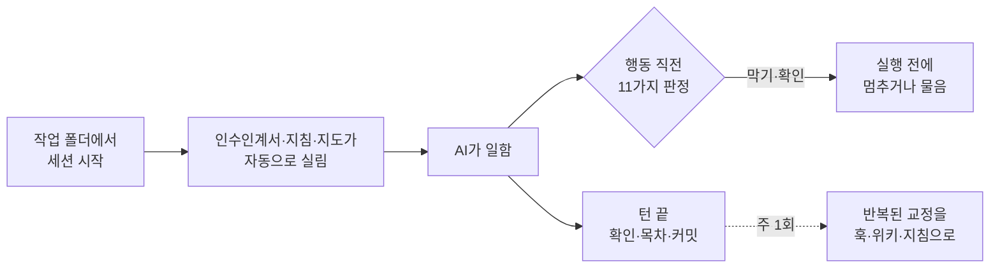

# ORAENA

Claude Code와 Codex가 같은 실수를 되풀이하지 않게 하는 개인 위키 하네스.

상태: 개발 중 · 2026.10.13 · Windows에서 Claude Code 2.1.211, Codex 0.162.1로 확인



## 주요 기능

- **인수인계서 자동 싣기** — 작업 폴더를 열면 그 일의 지금 위치와 다음 작업이 실린다.
- **되돌릴 수 없는 행동 막기** — 비밀 커밋, 방화벽 열기 등 7가지를 실행 전에 막는다.
- **먼저 묻기** — push·게시, 폴더째 지우기, 시스템 설정, 전역 설치는 실행 전에 확인받는다.
- **표준 형식 위키** — 지식은 Google OKF 형식 폴더에 두고, 목차와 변경 기록은 자동으로 만든다.
- **주 1회 교정 정리** — 대화 기록에서 두 번째 나온 교정을 찾아 훅·위키·지침으로 옮긴다.

## 설치

Python 3.12, [uv](https://docs.astral.sh/uv/), git이 필요하다.

```powershell
git clone https://github.com/kimkuhyun/oraena
uv tool install .\oraena
```

## 빠른 시작

1. 데이터 폴더를 만들고 두 호스트에 건다: `oraena init <빈 폴더>`
2. 작업 폴더에 인수인계서를 붙인다: `oraena link my-project --folder <작업 폴더>`
3. Codex만: `/hooks`에서 oraena 훅 5개를 신뢰한다.

그다음 그 작업 폴더에서 Claude Code나 Codex를 평소처럼 연다.

AI가 `git push`를 하려 하면 실행 전에 이 이유와 함께 확인을 묻는다(실제 출력):

```text
외부로 내보내는 행동(push, PR, 게시, 메시지)입니다. 이유: 개인 기록이 나가는 마지막 관문입니다.
```

## 작동 방식

| 훅 | 하는 일 |
|---|---|
| 세션 시작 | 인수인계서를 싣는다. 압축 뒤에는 지침과 지도도 다시 싣는다 |
| 발화 | "스킬"이라고 하면 스킬 목록을 넣는다 |
| 행동 직전 | 11가지를 판정해 막거나 묻는다 |
| 행동 뒤 | 위키 형식을 검사하고, 빈 검색에 비슷한 문서를 알린다 |
| 턴 끝 | 스킬을 읽었나, 인수인계서를 고쳤나 본다. 목차를 만들고 커밋한다 |

| 데이터 폴더 | 담는 것 |
|---|---|
| `wiki/` | 위키 문서(OKF): 사실, 방법, 결정, 인수인계서 |
| `raw/` | 원시 기록. 새 파일만 쓴다 |
| `agent/` | 상시 지침, 스킬 |

## 문서

- [명령, 막기·확인 목록, 설치가 바꾸는 파일](docs/reference.md)

## 현재 상태와 한계

- Windows에서만 확인했다. 교정 반복이 실제로 줄었는지는 아직 재는 중이다.
- 훅 스크립트가 아예 뜨지 않으면 막지 못한다. Claude는 설정 파일 편집만 권한 규칙으로 따로 막는다.
- 0.3 이전 판은 이력에서 지웠다.

## 라이선스

All rights reserved. © 2026 kimkuhyun
