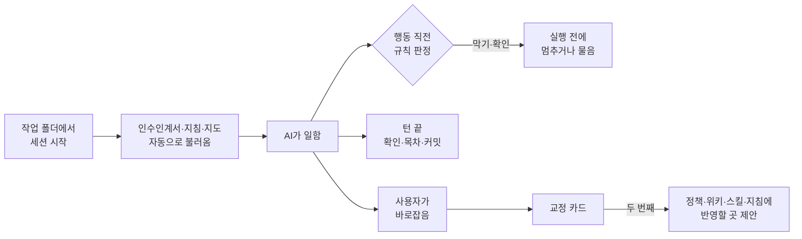

<div align="center">

# ORAENA

**Claude Code와 Codex가 같은 실수를 되풀이하지 않게 하는 개인 위키 하네스**

[명령·규칙 형식](docs/reference.md) • [작동 방식](#작동-방식) • [핵심 개념](#핵심-개념) • [측정](#측정) • [한계](#현황과-한계)


</div>

---

## ORAENA란?

AI는 세션이 끝나면 지적받은 것을 잊고 같은 실수를 되풀이한다.

ORAENA는 사용자의 교정을 그 자리에서 기록하고, 같은 교정이 반복되면 정책·위키·스킬·지침 중 알맞은 곳에 반영해 다음 세션부터 AI가 지키게 한다.

지식은 사람이 읽는 Markdown 위키에 두고, Claude Code와 Codex가 같은 원본을 쓰게 한다.

**Contents**

- [특징](#특징)
- [작동 방식](#작동-방식)
- [핵심 개념](#핵심-개념)
- [처음에 쓸 것](#처음에-쓸-것)
- [측정](#측정)
- [구성](#구성)
- [현황과 한계](#현황과-한계)

---

## 특징

**일하는 중**

- **필요할 때만 불러오기** — 인수인계서는 세션을 시작할 때, 스킬 목록은 스킬을 말할 때, 비슷한 문서는 검색 결과가 없을 때 불러온다.
- **같은 원본, 두 도구** — 지침·스킬·훅을 한 곳에 두고 Claude Code와 Codex에 함께 연결한다.

**지키기**

- **규칙은 파일** — 막거나 확인받는 규칙을 데이터 폴더에 파일 하나씩 두고, 코드를 고치거나 다시 설치하지 않고 바꾼다.
- **모델을 부르지 않는다** — 문자열과 경로만 보고 막을지 정한다.
- **고장 나면 막는다** — 판정 중 오류가 나면 실행하지 않고 사용자에게 알린다.
- **AI가 풀 수 없는 경계** — AI는 훅·설정·설치본·정책 규칙을 바꿀 수 없다.

**쌓기**

- **그 자리에서 교정 기록** — 사용자가 바로잡으면 AI가 교정 카드를 남기고, 같은 교정이 두 번째 나오면 어디에 반영할지 바로 제안한다.
- **스킬은 제안으로** — 같은 절차가 반복되면 AI가 초안을 제안하고, 사용자가 승인하면 스킬로 만든다.
- **주간 정리** — 놓친 교정을 골라내고 반복 비율을 센다.
- **위키가 원본** — 사람이 읽는 Markdown(Google OKF 0.2)이고 목차·색인은 다시 만드는 파생물이다.
- **원시 기록은 불변** — `raw/`에는 새 파일만 쓰고 기존 파일은 고칠 수 없다.
- **로컬 이력** — 턴 끝에 목차를 만들고 데이터 폴더를 자동 커밋한다.

**다루기**

- **되돌릴 수 있는 설치** — 백업한 뒤 ORAENA가 표시한 블록만 고친다. `--dry-run`과 `disconnect`도 지원한다.
- **0.3 저장소 이전** — `oraena migrate`로 옛 형식을 새 형식으로 옮긴다.

---

## 작동 방식



| 훅 | 하는 일 |
|---|---|
| 세션 시작 | 인수인계서를 불러오고, 압축 뒤에는 지침과 지도도 다시 불러온다 |
| 발화 | 교정하는 말이 보이면 교정 카드 안내를, "스킬"이라는 말이 보이면 스킬 목록을 넣는다 |
| 행동 직전 | 핵심 규칙 3가지와 정책 규칙으로 판정해 막거나 묻는다 |
| 행동 뒤 | 위키 형식을 검사하고 검색이 비면 비슷한 문서를 알린다 |
| 턴 끝 | 밝힌 스킬을 읽었는지, 인수인계서를 고쳤는지 확인하고 목차를 만들어 커밋한다 |

AI가 하네스 설정을 고치려 하면 실행 전에 막고 이유를 알린다(실제 출력):

```text
하네스 설정(훅, settings.json, config.toml, 플러그인, oraena 설치본)을 AI가 바꾸지 마세요. 이유: AI가 자기 경계를 풀 수 있으면 경계가 아닙니다. 바꿀 내용과 명령을 사용자에게 보여 주세요.
```

---

## 핵심 개념

### 세 층

| 층 | 담는 것 |
|---|---|
| `agent/` | 지시: 상시 지침, 스킬, 정책 규칙 |
| `wiki/` | 지금까지 정리한 이해: 사실, 방법, 결정, 인수인계서 |
| `raw/` | 근거 기록: 새 파일만 쓴다(교정 카드, 규칙 제안 포함) |

### 반영할 곳

같은 교정이 두 번째 나오면 위에서부터 처음 맞는 곳 한 군데에 반영한다.

| 순서 | 곳 | 조건 |
|---|---|---|
| 1 | 기존 지침 줄 수정·삭제 | 이미 있는 줄 |
| 2 | 정책 규칙 | 기계가 판정할 수 있다(제안 파일을 사람이 옮긴다) |
| 3 | 위키 | 몰라서 틀렸다 |
| 4 | 스킬 | 되풀이하는 절차다(제안 파일을 쓰고, 승인하면 작성한다) |
| 5 | 상시 지침 | 그 밖의 선호(크기가 고정이라 하나를 넣으면 하나를 뺀다) |

### 규칙

- **핵심 3가지** — 하네스 설정, 정책 규칙 폴더, `raw/`의 기존 파일. 엔진에 내장돼 있고 항상 막는다.
- **정책 규칙** — 그 밖에 막거나 확인받을 행동은 `agent/policy/`에 규칙 하나당 파일 하나로 둔다. 처음에는 비어 있고 교정이 쌓이면서 늘어난다.

---

## 처음에 쓸 것

개인 지침과 규칙은 저장소에 들어 있지 않다. 설치한 뒤 데이터 폴더에 직접 채운다. 형식은 [레퍼런스](docs/reference.md)에 있다.

| 곳 | 쓸 것 | 처음 상태 |
|---|---|---|
| `agent/AGENTS.md` | 항상 지킬 개인 지침(말투, 작업 방식, 환경) | 하네스 사용법만 있다 |
| `agent/policy/` | 막거나 물을 행동(예: push 전 확인) | 비어 있다 |
| `agent/skills/` | 직접 쓰지 않는다. 반복되는 절차를 AI가 제안한다 | 비어 있다 |
| `wiki/` | 인수인계서와 지식 문서. 일하면서 AI가 쓴다 | 비어 있다 |

---

## 측정

성공 기준은 **같은 교정의 반복 감소**다. 아래는 재구축 전 30일 기준값이다(`oraena analyze`).

| 지표 | Claude Code | Codex |
|---|---|---|
| 세션 수 | 80 | 41 |
| 세션당 도구 호출(중앙값) | 183 | 142 |
| 훅이 막은 횟수 | 50 | 기록에 안 보임 |

| 지표 | 값 |
|---|---|
| 검색 결과가 비어 있던 비율 | 7.9% (457회 중 36회) |
| 교정 후보 발화 | 548개(낱말 규칙으로만 거른 값, 판정 전) |

반복 교정 비율은 교정 카드로 세고, 기준값은 첫 주간 정리에서 정한다.

---

## 구성

| | |
|---|---|
| **데이터 폴더** | `wiki/` · `raw/` · `agent/`, 위치는 `~/.oraena.json` |
| **연결 파일** | Claude `settings.json`·`CLAUDE.md`, Codex `hooks.json`·`AGENTS.md`, 스킬은 폴더 링크(정션) |
| **훅 진입점** | `oraena hook <이벤트> --host claude\|codex`, 이벤트별 모듈 5개 |
| **판정** | 핵심 규칙 3가지와 정책 파일(정규식·경로), 모델 호출 없음 |
| **이력** | 데이터 폴더의 로컬 git(원격 없음) |
| **지표** | `oraena analyze`가 지표·교정 카드·교정 후보·별칭 후보를 뽑는다 |
| **의존성** | Python 3.12+, PyYAML |
| **설치** | 이 저장소를 Claude Code나 Codex에 주고 시키면 된다 |

---

## 현황과 한계

- Windows에서 Claude Code 2.1.211, Codex 0.162.1로만 확인했다.
- 교정 반복이 실제로 줄었는지는 아직 재는 중이다.
- 정책 규칙과 스킬은 처음에는 비어 있고, 쓰면서 AI가 제안한 것이 쌓인다.
- 훅 스크립트가 아예 실행되지 않으면 막지 못한다. Claude는 설정 파일 편집만 권한 규칙으로 따로 막는다.
- Codex 훅에는 묻는 기능이 없어 확인 규칙도 막는다.
- 교정 카드는 AI가 판단해서 쓰므로 놓칠 수 있다. 놓친 것은 주간 정리가 보충한다.
- 0.3 이전 판은 이력에서 지웠다.

---

## 문서

- [명령, 핵심 규칙, 정책 규칙·교정 카드·스킬 제안 형식, 설치가 바꾸는 파일](docs/reference.md)

## 라이선스

All rights reserved. © 2026 kimkuhyun
